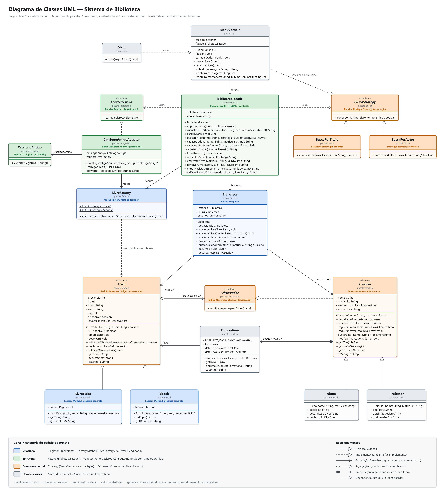

# Sistema de Biblioteca — Documentação Técnica

**Atividade:** Atividade Avaliativa em Grupo: Padrões de Projeto, GRASP e POO
**Linguagem:** Java (compatível com Java 8 ou superior) · **IDE:** Eclipse · **Interface:** console (texto)
**Integrantes:** _preencher com os nomes do grupo_

---

## 1. Nome e objetivo da aplicação

**Nome:** Sistema de Biblioteca (projeto Eclipse `BibliotecaLivros`).

**Objetivo:** controlar o acervo e os empréstimos de livros de uma biblioteca (por exemplo, a biblioteca de uma escola ou faculdade). O sistema cadastra livros e usuários, faz empréstimos e devoluções seguindo as regras de cada tipo de usuário, busca livros e avisa automaticamente quem estava esperando um livro quando ele é devolvido.

## 2. Problema que a aplicação resolve

Quando o controle da biblioteca é feito em caderno ou planilha, aparecem problemas como:

- não dá para saber rapidamente se um livro está disponível ou com quem ele está;
- é fácil emprestar mais livros do que o permitido ou perder o controle dos prazos de devolução;
- quem quer um livro que está emprestado precisa ficar perguntando se ele já voltou;
- o acervo que já existia está guardado em um **sistema antigo**, que exporta os dados em um formato de texto diferente do usado pelo sistema novo.

A aplicação resolve isso centralizando os dados do acervo e dos usuários, aplicando as regras de empréstimo automaticamente, mantendo uma lista de espera com aviso e importando os livros do sistema antigo sem precisar redigitar nada.

## 3. Principais funcionalidades

| Opção | Funcionalidade | Descrição |
|:---:|---|---|
| 1 | Listar livros | Mostra todos os livros com tipo, detalhes e situação (disponível, emprestado e quantas pessoas estão na lista de espera). |
| 2 | Buscar livros | Busca por **título** ou por **autor**, sem diferenciar maiúsculas de minúsculas. |
| 3 | Cadastrar livro | Cadastra um **livro físico** (com número de páginas) ou um **e-book** (com tamanho em MB). |
| 4 | Listar usuários | Mostra cada usuário com seus empréstimos (data do empréstimo e data de devolução) e a quantidade de avisos. |
| 5 | Cadastrar usuário | Cadastra um **aluno** ou um **professor**. A matrícula não pode se repetir. |
| 6 | Emprestar livro | Empresta um livro disponível, respeitando o limite do usuário, e calcula a data de devolução. |
| 7 | Devolver livro | Registra a devolução e **avisa os usuários da lista de espera**. |
| 8 | Entrar na lista de espera | Coloca o usuário na lista de espera de um livro que está emprestado. |
| 9 | Ver avisos | Mostra os avisos recebidos pelo usuário. |
| 0 | Sair | Encerra o programa. |

**Regras de empréstimo:**

| Tipo de usuário | Livros ao mesmo tempo | Prazo de devolução |
|---|:---:|:---:|
| Aluno | 2 | 7 dias |
| Professor | 5 | 14 dias |

**Outras regras e validações:**

- Um livro emprestado só pode ser emprestado de novo depois de devolvido.
- Só quem está com o livro pode devolvê-lo.
- Só é possível entrar na lista de espera de um livro emprestado. A mesma pessoa não entra duas vezes, e quem já está com o livro não pode entrar.
- Quando o livro é devolvido, todos da lista de espera recebem um aviso e a lista é esvaziada.
- Ao iniciar, o sistema importa 7 livros do catálogo antigo e cadastra 3 usuários de teste: `A01` (Ana Souza, Aluno), `A02` (Bruno Lima, Aluno) e `P01` (Carla Mendes, Professor).
- Entradas inválidas (letras no lugar de números, opção fora do menu, campos vazios, matrícula repetida, usuário ou livro inexistente) geram mensagens de erro, e o programa continua funcionando.

## 4. Padrões de projeto utilizados

| Categoria | Padrão | Onde está no código |
|---|---|---|
| Criacional | **Singleton** | `servico/Biblioteca.java` |
| Criacional | **Factory Method** | `fabrica/LivroFactory.java` (cria `LivroFisico` ou `Ebook`) |
| Estrutural | **Facade** | `servico/BibliotecaFacade.java` |
| Estrutural | **Adapter** | `integracao/CatalogoAntigoAdapter.java` (com `FonteDeLivros` e `CatalogoAntigo`) |
| Comportamental | **Strategy** | pacote `busca`: `BuscaStrategy`, `BuscaPorTitulo`, `BuscaPorAutor` |
| Comportamental | **Observer** | `observador/Observador.java`, `modelo/Livro.java`, `modelo/Usuario.java` |

No código, cada padrão está identificado por um comentário `PADRAO ...` no início da classe principal dele, e os pontos onde ele é usado também têm comentários.

## 5. Onde e por que cada padrão foi implementado

### 5.1 Singleton — `Biblioteca` (criacional)

- **Onde:** `servico/Biblioteca.java`. A `BibliotecaFacade` obtém a instância com `Biblioteca.getInstancia()`.
- **Problema:** o acervo e os usuários precisam existir em um lugar só. Se desse para criar duas bibliotecas, um livro poderia aparecer emprestado em uma e disponível na outra.
- **Como foi feito:** o construtor é `private` (ninguém consegue fazer `new Biblioteca()`), um atributo `static` guarda a única instância e o método `static getInstancia()` cria a instância só na primeira chamada. Nas próximas chamadas, ele devolve sempre a mesma.
- **Contribuição:** garante dados consistentes e um único ponto de acesso ao acervo.

### 5.2 Factory Method — `LivroFactory` (criacional)

- **Onde:** `fabrica/LivroFactory.java`, método `criarLivro(...)`. É usado em **dois lugares**: no cadastro pelo menu (`BibliotecaFacade.cadastrarLivro`) e na importação do catálogo antigo (`CatalogoAntigoAdapter.carregarLivros`).
- **Problema:** existem dois tipos de livro (`LivroFisico` e `Ebook`). Sem a fábrica, os dois lugares que criam livros precisariam conhecer as duas classes e repetir o mesmo `if/else` para escolher qual criar.
- **Como foi feito:** quem precisa de um livro chama `criarLivro(tipo, titulo, autor, ano, informacaoExtra)`. A fábrica decide qual subclasse instanciar e devolve um `Livro` (a classe abstrata). Foi usada a variação **parametrizada** do Factory Method, descrita no livro do GoF: um método fábrica que recebe como parâmetro o tipo de produto a criar. Os tipos aceitos ficam em constantes (`LivroFactory.FISICO` e `LivroFactory.EBOOK`), o que evita erros de digitação.
- **Contribuição:** o resto do sistema não depende das classes concretas. Para criar um novo tipo de livro (por exemplo, `Audiobook`), só a fábrica muda.

### 5.3 Facade — `BibliotecaFacade` (estrutural)

- **Onde:** `servico/BibliotecaFacade.java`. O `MenuConsole` faz todas as operações através dela.
- **Problema:** cada operação envolve várias classes. Para emprestar um livro, por exemplo, é preciso encontrar o usuário e o livro na `Biblioteca`, verificar se o livro está disponível e se o usuário ainda pode pegar livros, marcar o livro como emprestado e registrar o empréstimo no usuário. Se o menu fizesse tudo isso, ele ficaria dependente de todas essas classes.
- **Como foi feito:** a fachada oferece métodos simples (`emprestarLivro`, `devolverLivro`, `buscarLivros`, `cadastrarLivro`...) e, por dentro, coordena `Biblioteca`, `LivroFactory`, `Livro`, `Usuario` e `Emprestimo`.
- **Contribuição:** a interface com o usuário fica simples e desacoplada das regras. Se uma regra interna mudar, o menu continua igual. A Facade também faz o papel de **Controller** do GRASP.

### 5.4 Adapter — `CatalogoAntigoAdapter` (estrutural)

- **Onde:** pacote `integracao`.
  - `FonteDeLivros`: interface que o nosso sistema espera (**Target**);
  - `CatalogoAntigo`: sistema antigo, que não pode ser alterado (**Adaptee**);
  - `CatalogoAntigoAdapter`: o adaptador (**Adapter**);
  - o cliente é `BibliotecaFacade.importarLivros(FonteDeLivros)`, chamado quando o programa inicia.
- **Problema:** o sistema antigo exporta os livros como linhas de texto (por exemplo, `F;Dom Casmurro;Machado de Assis;1899;256`), mas o sistema novo trabalha com objetos `Livro`. As interfaces são incompatíveis.
- **Como foi feito:** o adaptador implementa `FonteDeLivros`. No método `carregarLivros()`, ele chama `exportarRegistros()` do catálogo antigo, separa os campos de cada linha, converte o código de tipo antigo (`F`/`E`) e cria os objetos com a `LivroFactory`.
- **Contribuição:** os dados antigos são reaproveitados sem alterar nenhum dos dois lados. Como a Facade só conhece a interface `FonteDeLivros`, outra fonte de dados (um arquivo CSV, por exemplo) seria só mais uma classe implementando essa interface.

### 5.5 Strategy — busca de livros (comportamental)

- **Onde:** pacote `busca`: interface `BuscaStrategy` e estratégias `BuscaPorTitulo` e `BuscaPorAutor`. O contexto é `BibliotecaFacade.buscarLivros(termo, estrategia)`, e quem escolhe a estratégia é o `MenuConsole` (opção 2 do menu).
- **Problema:** existem jeitos diferentes de buscar livros. Colocar todos num método só, cheio de `if/else`, faria esse método crescer a cada nova forma de busca.
- **Como foi feito:** cada estratégia implementa `corresponde(livro, termo)`. O método `buscarLivros` percorre o acervo sempre do mesmo jeito e só pergunta para a estratégia recebida se cada livro corresponde ao termo.
- **Contribuição:** para criar uma busca nova (por ano, por exemplo), basta criar outra classe que implemente `BuscaStrategy`, sem mexer no código que já existe.

### 5.6 Observer — lista de espera com aviso (comportamental)

- **Onde:** `observador/Observador.java` (interface **Observer**), `modelo/Livro.java` (**Subject**, o objeto observado) e `modelo/Usuario.java` (implementa `Observador`). Aparece nas opções 7 (devolver), 8 (lista de espera) e 9 (ver avisos).
- **Problema:** quando um livro está emprestado, outras pessoas querem saber quando ele voltar. Sem o padrão, quem faz a devolução teria que conhecer e avisar cada interessado manualmente.
- **Como foi feito:** o usuário entra na lista de espera com `livro.adicionarObservador(usuario)`. Quando o livro é devolvido, `devolver()` chama `notificarObservadores()`, que chama `notificar(mensagem)` em cada observador e depois esvazia a lista. O `Usuario` guarda a mensagem nos seus avisos.
- **Contribuição:** o `Livro` não depende da classe `Usuario`, só da interface `Observador` (baixo acoplamento). Qualquer outra classe que implemente `Observador` (um painel de avisos ou um envio de e-mail, por exemplo) poderia ser avisada sem nenhuma mudança no `Livro`.

### 5.7 Como os padrões trabalham juntos

**Inicialização do sistema:**

1. `Main` cria o `MenuConsole`, que cria a `BibliotecaFacade`.
2. A Facade pega a única `Biblioteca` com `getInstancia()` (**Singleton**).
3. O menu chama `facade.importarLivros(new CatalogoAntigoAdapter(new CatalogoAntigo()))` (**Facade** + **Adapter**).
4. O adaptador converte cada linha de texto e cria os livros com a `LivroFactory` (**Factory Method**).

**Devolução de um livro que tem lista de espera:**

1. O menu chama `facade.devolverLivro(matricula, id)` (**Facade**).
2. A Facade encontra o usuário e o livro na `Biblioteca` (**Singleton**) e confere se o usuário está com o livro.
3. `usuario.registrarDevolucao(livro)` remove o empréstimo, e `livro.devolver()` marca o livro como disponível.
4. `devolver()` chama `notificarObservadores()`, que avisa cada usuário da lista de espera (**Observer**).

## 6. Princípios GRASP aplicados

| Princípio | Onde | Como foi aplicado |
|---|---|---|
| **Controller** (Controlador) | `BibliotecaFacade` | Recebe todos os pedidos do menu e distribui o trabalho. O menu não tem regra de negócio. |
| **Information Expert** (Especialista na Informação) | `Usuario.podePegarEmprestado()`, `Usuario.estaComLivro()`, `Livro.isDisponivel()`, `Biblioteca.buscarLivroPorId()`, `Emprestimo` | Cada responsabilidade fica com a classe que tem os dados necessários. Por exemplo, quem sabe se o usuário atingiu o limite é o próprio `Usuario`, que conhece seus empréstimos e seu limite. O `Emprestimo` calcula a sua data de devolução. |
| **Creator** (Criador) | `Usuario.registrarEmprestimo()`, `LivroFactory` | O `Usuario` guarda seus empréstimos e conhece o próprio prazo, por isso é ele quem cria o `Emprestimo`. Os livros são criados pela `LivroFactory`. |
| **Low Coupling** (Baixo acoplamento) | `MenuConsole`, `BibliotecaFacade`, `Livro` | O `MenuConsole` não acessa a `Biblioteca` nem altera livros e usuários diretamente: toda operação passa pela Facade. A Facade depende das interfaces `FonteDeLivros` e `BuscaStrategy`, e não das classes concretas. O `Livro` depende só da interface `Observador`. |
| **High Cohesion** (Alta coesão) | Todos os pacotes e classes | Cada classe tem uma responsabilidade clara: `MenuConsole` cuida só de entrada e saída, `Biblioteca` só guarda os dados, `LivroFactory` só cria livros e cada estratégia só sabe comparar de um jeito. |
| **Polymorphism** (Polimorfismo) | `Usuario`, `Livro`, estratégias de busca, `Observador` | As diferenças entre tipos são resolvidas com métodos sobrescritos (`getLimiteDeLivros`, `getPrazoEmDias`, `getTipo`, `getDetalhes`, `corresponde`), e não com `if (tipo == ...)`. |
| **Pure Fabrication** (Invenção pura) | `LivroFactory`, `BibliotecaFacade`, `MenuConsole`, estratégias de busca | São classes que não existem no "mundo real" da biblioteca. Foram criadas para manter a coesão alta e o acoplamento baixo. |
| **Indirection** (Indireção) | `BibliotecaFacade`, `CatalogoAntigoAdapter` | Um intermediário evita que dois lados dependam diretamente um do outro: o menu e o modelo, e o sistema novo e o sistema antigo. |
| **Protected Variations** (Variações protegidas) | Interfaces `FonteDeLivros`, `BuscaStrategy`, `Observador` | Os pontos que podem mudar (nova fonte de livros, nova busca, novo tipo de observador) ficam protegidos atrás de interfaces. |

## 7. Conceitos de POO utilizados

| Conceito | Onde aparece no código |
|---|---|
| Classes, objetos, atributos e métodos | Em todas as classes. Os objetos são criados com `new` (por exemplo, `new MenuConsole()` e `new Aluno(...)`). |
| Encapsulamento e controle de acesso | Todos os atributos são `private` e acessados por métodos `public`. Os construtores de `Livro` e `Usuario` são `protected` (só as subclasses usam), o construtor da `Biblioteca` é `private` (Singleton) e os métodos auxiliares são `private` (por exemplo, `notificarObservadores` e `buscarEmprestimo`). As listas são devolvidas como cópia (`getLivros()`, `getEmprestimos()`), então ninguém altera a lista original por fora. |
| Herança | `LivroFisico` e `Ebook` herdam de `Livro`. `Aluno` e `Professor` herdam de `Usuario`. As subclasses chamam o construtor da superclasse com `super(...)`. |
| Composição e agregação | `Usuario` tem uma lista de `Emprestimo` (composição), e cada `Emprestimo` tem um `Livro`. A `Biblioteca` tem listas de `Livro` e de `Usuario`, e o `Livro` tem a lista de espera (`List<Observador>`). A `BibliotecaFacade` tem uma `Biblioteca` e uma `LivroFactory`, e o adaptador tem um `CatalogoAntigo`. |
| Polimorfismo | A lista `List<Livro>` guarda `LivroFisico` e `Ebook`, e o `toString()` chama o `getTipo()` e o `getDetalhes()` de cada um. `podePegarEmprestado()` usa `getLimiteDeLivros()`, que responde 2 ou 5 conforme o objeto. `buscarLivros` funciona com qualquer `BuscaStrategy`, e `cadastrarUsuario(Usuario)` recebe tanto `Aluno` quanto `Professor`. |
| Abstração e classes abstratas | `Livro` e `Usuario` são `abstract`, com métodos abstratos (`getTipo`, `getDetalhes`, `getLimiteDeLivros`, `getPrazoEmDias`). |
| Interfaces | `Observador`, `BuscaStrategy` e `FonteDeLivros`. |
| Sobrescrita (`@Override`) | `getTipo`, `getDetalhes`, `getLimiteDeLivros`, `getPrazoEmDias`, `toString`, `notificar`, `corresponde` e `carregarLivros`. |
| Sobrecarga | `Biblioteca.adicionarLivro(Livro)` e `adicionarLivro(List<Livro>)`. `MenuConsole.lerInteiro(String)` e `lerInteiro(String, int, int)`. |
| Membros estáticos | `Biblioteca.instancia` e `getInstancia()`, `Livro.proximoId` (gera os ids) e as constantes `LivroFactory.FISICO` e `LivroFactory.EBOOK`. |
| Tratamento de exceções | `MenuConsole.lerInteiro` usa `try/catch` para `NumberFormatException`. |
| Validação do tipo de livro | A `LivroFactory` retorna `null` para um tipo desconhecido. A `BibliotecaFacade` verifica esse retorno e devolve uma mensagem de erro sem cadastrar o livro. O adaptador também verifica o retorno antes de adicionar à lista. |

## 8. Como executar no Eclipse

**Requisitos:** Eclipse IDE for Java Developers e um JDK 8 ou superior (as versões atuais do Eclipse já vêm com um). O projeto não usa bibliotecas externas.

**Importar o projeto:**

1. Abra o Eclipse e vá em **File > Import...**
2. Escolha **General > Existing Projects into Workspace** e clique em **Next**.
3. Em **Select root directory**, clique em **Browse...** e selecione a pasta `BibliotecaLivros`. Se o projeto estiver em um arquivo `.zip`, use **Select archive file**.
4. Marque o projeto **BibliotecaLivros** e clique em **Finish**.

**Executar:**

1. No **Package Explorer**, abra `src > app > Main.java`.
2. Clique com o botão direito em `Main.java` e escolha **Run As > Java Application**.
3. O menu aparece na aba **Console**. Clique dentro do Console para digitar as opções.

**Se aparecer erro de JRE** (projeto marcado em vermelho): clique com o botão direito no projeto, vá em **Properties > Java Build Path > Libraries**, remova a JRE com erro e use **Add Library... > JRE System Library > Workspace default JRE**.

### Roteiro de demonstração

Sugestão de sequência para mostrar todas as funcionalidades e os seis padrões na apresentação:

| Passo | Opção | O que digitar | O que mostra |
|:---:|:---:|---|---|
| 1 | — | (executar o programa) | **Adapter** + **Factory Method**: 7 livros importados do catálogo antigo |
| 2 | 1 | — | Livros físicos e e-books na mesma lista (**polimorfismo**) |
| 3 | 2 | `2`, `machado` | **Strategy**: busca por autor (2 resultados) |
| 4 | 2 | `1`, `java` | **Strategy**: busca por título |
| 5 | 3 | `2`, `Entendendo Algoritmos`, `Aditya Bhargava`, `2017`, `12` | **Factory Method**: cadastro de um e-book (recebe o id 8) |
| 6 | 6 | `A01`, `1` | Empréstimo para aluno, com devolução em 7 dias |
| 7 | 6 | `A02`, `1` | Tentativa de pegar um livro que já está emprestado |
| 8 | 8 | `A02`, `1` | **Observer**: Bruno entra na lista de espera |
| 9 | 6 | `A01`, `2` e depois `A01`, `3` | Limite do aluno: o segundo livro é emprestado, o terceiro é recusado |
| 10 | 7 | `A01`, `1` | **Observer**: a devolução avisa 1 usuário |
| 11 | 9 | `A02` | O aviso chegou para o Bruno |
| 12 | 6 | `P01`, `3` | Empréstimo para professor, com devolução em 14 dias |
| 13 | 4 | — | Usuários com seus empréstimos, datas e avisos |

---

## Diagrama de classes UML



O arquivo `docs/diagrama-uml.png` está em alta resolução, então dá para dar zoom ou imprimir. As cores mostram a categoria de cada padrão: azul para criacional, verde para estrutural, laranja para comportamental e cinza para as demais classes. Cada classe mostra o pacote a que pertence e o seu papel no padrão (por exemplo, "Adapter: Target").

## Estrutura do projeto

```
BibliotecaLivros/
├── src/
│   ├── app/          Main (inicia o programa) e MenuConsole (menu de texto)
│   ├── servico/      Biblioteca (Singleton) e BibliotecaFacade (Facade / Controller)
│   ├── modelo/       Livro, LivroFisico, Ebook, Usuario, Aluno, Professor, Emprestimo
│   ├── fabrica/      LivroFactory (Factory Method)
│   ├── busca/        BuscaStrategy, BuscaPorTitulo, BuscaPorAutor (Strategy)
│   ├── integracao/   FonteDeLivros, CatalogoAntigo, CatalogoAntigoAdapter (Adapter)
│   └── observador/   Observador (Observer)
├── docs/
│   ├── DOCUMENTACAO.md   (este documento)
│   └── diagrama-uml.png
├── .project, .classpath, .settings/   (configuração do Eclipse)
└── README.md
```
